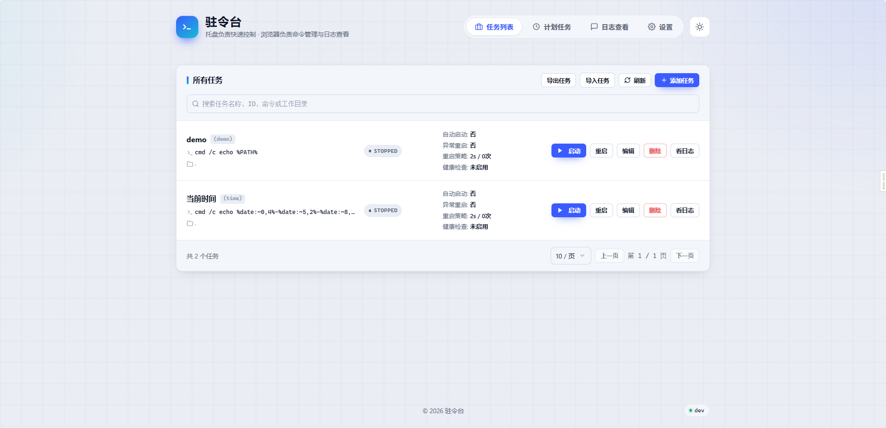
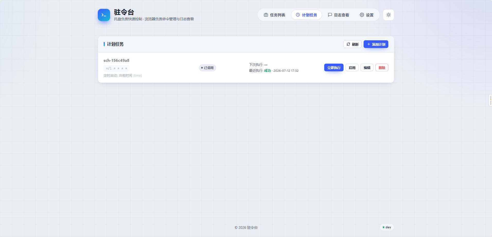
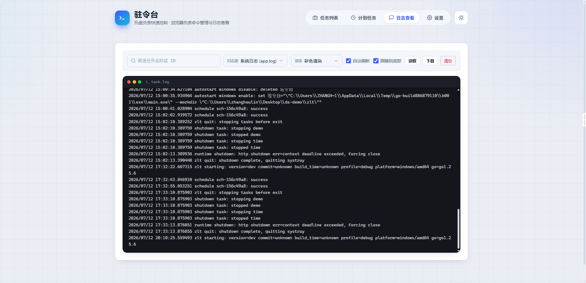
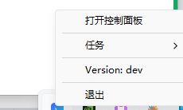
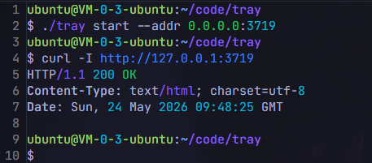

# 驻令台

> 用 Windows 托盘快速启停，用浏览器统一管理本地脚本和服务。


驻令台将分散运行的脚本、守护进程和辅助服务集中到一个管理面板，提供任务启停、参数配置、异常重启、健康检查、Cron 调度和日志查看。Windows 支持系统托盘；Linux 和 macOS 使用命令行与网页面板。

[下载发行版](https://github.com/zhilv666/zlt/releases/latest) · [版本记录](./CHANGELOG.md) · [问题反馈](https://github.com/zhilv666/zlt/issues)

本文对应当前 `main` 分支。JSON 参数表单和 Linux 自启自定义参数需使用包含这些改动的版本；发行版的变化以 [CHANGELOG.md](./CHANGELOG.md) 和对应 Release 为准。

## 目录

- [功能与平台支持](#功能与平台支持)
- [快速开始](#快速开始)
- [运行命令与工作目录](#运行命令与工作目录)
- [任务配置](#任务配置)
- [Cron 计划任务](#cron-计划任务)
- [软件开机自启](#软件开机自启)
- [访问鉴权与远程访问](#访问鉴权与远程访问)
- [日志与数据管理](#日志与数据管理)
- [HTTP API](#http-api)
- [常见问题](#常见问题)
- [开发与发布](#开发与发布)
- [界面截图](#界面截图)

## 功能与平台支持

- 网页增删改任务、启停任务，查看状态、PID 和退出信息
- 任务参数、工作目录和环境变量配置，JSON 导入与导出
- 随驻令台启动任务，异常退出后按策略重启，HTTP 健康检查
- Cron 定时启动、停止或重启任务，支持时区和立即执行
- 任务与计划搜索、分页和拖拽排序，配置保存在 SQLite
- 实时任务状态与日志，ANSI 彩色渲染、复制、下载和清理
- 日志按大小轮转，保留最近运行记录；网页调整日志级别和保留数量
- 访问密钥、浏览器会话和 CSRF 保护，闲置 7 天过期

| 能力 | Windows | Linux | macOS |
| --- | --- | --- | --- |
| 网页任务、计划和日志管理 | 支持 | 支持 | 支持 |
| 系统托盘 | 支持 | 无 | 无 |
| 前台 `run`、后台 `start` | 支持 | 支持 | 支持 |
| 软件自启管理 | 当前用户登录自启 | systemd 用户或系统服务、OpenWrt procd | 暂不支持 |
| 发行包架构 | amd64、arm64 | amd64、arm64 | amd64、arm64 |

任务以驻令台进程的操作系统用户身份运行。Python、Node.js 等解释器及任务本身的依赖需要自行安装。

## 快速开始

### 使用发行包

从 [Releases](https://github.com/zhilv666/zlt/releases) 下载对应系统和架构的文件。`amd64` 适用于常见 Intel/AMD 64 位设备，`arm64` 适用于 ARM 64 位设备，包括 Apple Silicon。发行包无需安装 Go 或 Task。

| 系统 | 文件名格式 | 使用方式 |
| --- | --- | --- |
| Windows | `zlt-vX.Y.Z-windows-amd64.exe` | 放到固定目录，可重命名为 `zlt.exe` |
| Linux | `zlt-vX.Y.Z-linux-amd64.tar.gz` | 解压得到 `zlt` |
| macOS | `zlt-vX.Y.Z-darwin-arm64.tar.gz` | 解压得到 `zlt` |

以下发行包示例统一使用 `zlt` / `zlt.exe`。`vX.Y.Z` 和架构需替换为下载文件的实际名称。

Windows：将程序放到如 `D:\Apps\zlt` 的目录，双击 `zlt.exe`，从托盘菜单选择“打开控制面板”。默认地址为 `http://127.0.0.1:3719`，首次登录密钥可从托盘“查看访问密钥”获取。

Linux / macOS：在准备长期保存数据的目录中解压并启动。以下以 Linux amd64 为例：

```sh
mkdir -p ~/apps/zlt
cd ~/apps/zlt
tar -xzf /path/to/zlt-vX.Y.Z-linux-amd64.tar.gz
chmod +x ./zlt
./zlt start
./zlt status
./zlt auth show
```

浏览器打开 `http://127.0.0.1:3719`，输入 `auth show` 输出的密钥。服务器部署的远程访问方式见[访问鉴权与远程访问](#访问鉴权与远程访问)。

### 从源码运行

需要 Go 1.25+ 和 Git；完整构建脚本还需要 `sh`，推荐安装 [Task](https://taskfile.dev/)。Windows 可使用 Git Bash。

```sh
git clone https://github.com/zhilv666/zlt.git
cd zlt
task build:current
```

Windows 构建结果为 `bin/zlt-current.exe`，可双击启动托盘。Linux / macOS 使用：

```sh
./bin/zlt-current run
```

也可直接以无界面模式从源码运行：

```sh
go run ./cmd/zlt run
```

## 运行命令与工作目录

### 常用命令

| 命令 | 行为 |
| --- | --- |
| `zlt` | Windows 启动托盘；Linux/macOS 前台运行，建议明确使用 `run` |
| `zlt run` | 无托盘前台运行，适合终端调试或由 systemd / procd 管理 |
| `zlt start` | 启动独立后台进程，启动成功后返回 |
| `zlt status` | 查看实例 PID 和实际监听地址，未运行时输出 `stopped` |
| `zlt stop` | 停止驻令台实例；Windows 后台模式强制终止进程树 |
| `zlt restart` | 停止实例后重新启动后台进程 |
| `zlt autostart enable/disable/status` | 管理软件自启 |
| `zlt auth show/reset/set` | 查看、重置或设置访问密钥 |
| `zlt version` | 查看版本、提交、构建时间和平台 |
| `zlt --help` | 查看完整帮助 |

CLI 的 `stop` / `restart` 操作整个驻令台实例。只操作某个任务时，使用网页、Windows 托盘或任务 API。

Linux/macOS 停止实例时会关闭调度器并停止管理的任务。Windows 托盘“退出”也会执行关闭流程；CLI 后台停止使用强制终止，需要任务完成退出处理时应先从网页停止任务。

```sh
# 前台模式使用 Ctrl+C 退出
./zlt run --listen 127.0.0.1:3719
```

后台模式：

```sh
./zlt start --listen 0.0.0.0:3719
./zlt status
./zlt restart --listen 0.0.0.0:3719
./zlt stop
```

`restart` 的启动参数取本次命令值。使用自定义地址时，重启也要带上 `--listen`，否则回到默认 `127.0.0.1:3719`。

### 参数与路径

| 参数 | 用途 | 默认值 |
| --- | --- | --- |
| `--listen <host:port>` / `--addr <host:port>` | `run`、`start`、`restart` 的 HTTP 监听地址；Linux 自启也可指定 | `127.0.0.1:3719` |
| `--pid-file <path>` | 实例状态文件和锁的位置；启停、状态查询需使用同一路径 | `data/zlt.pid` |
| `--workdir <path>` / `--work-dir <path>` | 执行命令前切换驻令台工作目录，包括数据和密钥管理命令 | 当前工作目录 |

运行数据位于**驻令台工作目录**下的 `data/`，不会自动放到可执行文件所在目录。任务自己的 `workdir` 只影响该任务，不改变驻令台的数据目录。

例如，从任意目录管理部署在 `/opt/zlt` 的同一个实例：

```sh
/opt/zlt/zlt start --workdir /opt/zlt --listen 0.0.0.0:3719
/opt/zlt/zlt status --workdir /opt/zlt
/opt/zlt/zlt auth show --workdir /opt/zlt
/opt/zlt/zlt stop --workdir /opt/zlt
```

默认配置下，同一工作目录只允许运行一个实例。Windows 重复启动托盘会打开已有实例的面板；重复 `run` / `start` 会报错。多个独立实例应分别使用不同工作目录和端口；仅修改 PID 文件不会隔离数据库、密钥或日志。

## 任务配置

登录网页后，在“任务”页面添加程序，填写名称、程序路径、运行参数和工作目录，再点击启动。编辑、删除任务前需先停止该任务。

### 程序、参数与环境变量

- “程序”填写可执行文件或解释器路径，参数放在“运行参数”中。
- 绝对程序路径直接使用；相对程序路径按任务工作目录解析；如工作目录中不存在 `python` 这样的程序名，则从驻令台启动时的 `PATH` 查询。
- 相对任务工作目录以驻令台工作目录为基准。服务器和自启部署建议使用绝对路径。
- 参数使用 **JSON 字符串数组**，每项对应一个参数，保留空格、空字符串和转义字符。
- 网页环境变量每行填写一项 `KEY=VALUE`；任务继承驻令台环境，并追加这些配置。

参数示例：

```json
["server", "--port", "5244"]
```

```json
["--config", "C:\\App Data\\config.json", ""]
```

程序通过参数数组直接启动，不会自动经 shell 执行，也不会展开管道、重定向、`$变量` 或通配符。需要 shell 语法时，明确指定 shell，例如程序 `/bin/sh`，参数 `["-c", "echo hello >> output.log"]`；Windows 可指定 `cmd.exe`，参数 `["/c", "echo hello"]`。

### 配置示例

Windows 程序：

```json
{
  "id": "openlist",
  "name": "OpenList",
  "program": "D:/SoftWare/OpenList/openlist.exe",
  "args": ["server"],
  "workdir": "D:/SoftWare/OpenList",
  "env": [],
  "autostart": false,
  "restart_on_crash": true,
  "stop_timeout_sec": 8,
  "restart_delay_sec": 2,
  "max_restart_count": 5,
  "health_check_url": "",
  "health_check_interval_sec": 0,
  "health_check_failure_threshold": 0
}
```

Python 虚拟环境：直接填写虚拟环境解释器路径，无需先执行 `activate`。

```json
{
  "id": "python-service",
  "name": "Python Service",
  "program": "/home/user/project/.venv/bin/python",
  "args": ["-u", "main.py", "--config", "config/settings.json"],
  "workdir": "/home/user/project",
  "env": ["APP_ENV=production"],
  "autostart": true,
  "restart_on_crash": true
}
```

Windows 虚拟环境对应使用 `.venv/Scripts/python.exe`。`-u` 让 Python 输出及时出现在日志面板中。

### 自动启动、异常重启与健康检查

| 字段 | 含义 | 默认值 |
| --- | --- | --- |
| `autostart` | 驻令台启动后自动启动该任务；与软件开机自启分别配置 | `false` |
| `restart_on_crash` | 驻令台启动的任务异常退出，或健康检查导致停止后，是否重启 | `false` |
| `stop_timeout_sec` | 停止任务时等待退出的秒数，超时后强制停止 | `8` |
| `restart_delay_sec` | 异常重启前等待秒数 | `2` |
| `max_restart_count` | 异常自动重启次数上限；`0` 表示不限 | `0` |
| `health_check_url` | HTTP/HTTPS 检查地址；留空关闭检查 | 空 |
| `health_check_interval_sec` | 启用检查时的间隔，单位秒 | `10` |
| `health_check_failure_threshold` | 连续失败多少次后停止任务 | `3` |

健康检查对配置的 URL 发起 GET，HTTP 2xx/3xx 视为成功，连接失败或 4xx/5xx 计为失败。达到阈值后停止任务；启用异常重启才会按策略再次启动。

正常退出（退出码 0）不会触发异常重启。手动停止或关闭异常重启策略会取消已经等待中的重启。手动启动或重启开启新一轮重试计数。

启动时可识别与任务程序路径和参数匹配的已有进程并接管，避免重复启动。接管不会重新绑定已有进程的标准输出；需要完整日志时，先停止原进程，再由驻令台启动。macOS 的工作目录校验使用系统自带的 `/usr/sbin/lsof`；无法读取进程身份时不会接管。

### 导入与导出

网页导出的 JSON 是**任务数组**。前面的单个配置对象需放入数组后才可导入。

- 导入覆盖整个任务列表，需先停止所有运行中的任务。
- 任务 ID 不可重复；建议使用 `python-service` 这样的稳定标识。
- 导入后，指向不存在任务的计划会停用；仍存在的任务 ID 可继续关联原计划。
- 导入完成后会启动 `autostart: true` 的任务。
- 导出不包含计划、应用设置、访问密钥、会话或日志。完整迁移见[备份与升级](#备份与升级)。

## Cron 计划任务

网页“计划任务”页面可为已登记任务配置 `start`、`stop` 或 `restart`，支持启用、停用、立即执行、下次执行时间和最近执行结果。

使用标准 5 段表达式：`分 时 日 月 星期`，无需秒字段。

| 表达式 | 含义 |
| --- | --- |
| `0 8 * * 1-5` | 工作日每天 08:00 |
| `0 23 * * *` | 每天 23:00 |
| `*/10 * * * *` | 每 10 分钟 |
| `30 9 * * 1` | 每周一 09:30 |

时区留空时跟随系统，也可填写 `Asia/Shanghai` 等 IANA 时区。任务以驻令台所在机器的时间执行。

执行规则：

- 已运行任务再次执行 `start`，或已停止任务再次执行 `stop`，会跳过。
- 同一计划上一次执行尚未结束时，跳过重复触发。
- 非法表达式或时区不能保存。
- 存在关联计划的任务不能直接删除，需先删除对应计划。
- 驻令台未运行期间不会触发计划，重新启动后不会补跑错过的执行。

## 软件开机自启

软件自启让驻令台随系统或用户会话启动；任务的 `autostart` 决定驻令台启动后拉起哪些任务。需要开机自动运行某个服务时，两处都要配置。

### Windows

通过网页“设置”或以下命令管理当前用户登录自启：

```powershell
.\zlt.exe autostart enable
.\zlt.exe autostart status
.\zlt.exe autostart disable
```

自启使用 `HKCU\Software\Microsoft\Windows\CurrentVersion\Run`，记录程序路径与启用时的工作目录。移动程序或部署目录后，需重新启用。此方式在用户登录后启动托盘，不是 Windows 系统服务。自定义 `--listen` 自启参数目前仅支持 Linux。

Linux 自启会自动识别 init 系统：OpenWrt 及其衍生版本（ImmortalWrt、LEDE 等）使用 BusyBox procd，其余发行版使用 systemd。启用后 `autostart status` 与网页“设置”会显示当前使用的管理器。

### Linux：systemd（选择服务作用域）

systemd 发行版上，作用域由执行命令的用户权限决定：

| 执行身份 | 配置文件 | 管理命令 |
| --- | --- | --- |
| 普通用户 | `~/.config/systemd/user/zhulingtai.service` | `systemctl --user` |
| root / sudo | `/etc/systemd/system/zhulingtai.service` | `sudo systemctl` |

普通用户服务适合用户会话；需要未登录时也随开机运行，可按部署需求配置 `loginctl enable-linger <用户名>`。系统服务默认以 root 运行。网页管理沿用当前驻令台进程的作用域。

启用时会执行 `daemon-reload` 和 `enable --now`，即启用自启并立即启动服务。若此前已用 `zlt start` 启动同一实例，应先停止旧实例，再交给 systemd。

### Linux：systemd 自定义监听地址

在原部署目录执行，以下以系统服务为例：

```sh
cd /opt/zlt
# 仅在已有手动启动的后台实例时执行
./zlt stop

sudo ./zlt autostart enable --listen 0.0.0.0:3719
sudo ./zlt autostart status
sudo systemctl status zhulingtai.service
```

生成的 unit 使用 `run --listen 0.0.0.0:3719`，工作目录取启用命令的当前目录。也可设置 `--pid-file data/custom.pid`；`--addr` 与 `--listen` 等价。

已有 unit 的处理：

- 不带参数执行 `autostart enable` 会保留已有文件，包括手工修改。
- 网页首次启用沿用当前监听地址，已有 unit 同样保留。
- 显式指定 `--listen` 或 `--pid-file` 会重新生成整个 unit 并执行 `daemon-reload`；其他手工定制需要重新写入。
- 更新时一并传入需要保留的监听地址和 PID 文件；未指定的选项使用默认值。
- 显式更新不会自动重启已经运行的服务，需执行 `sudo systemctl restart zhulingtai.service`。

### Linux：systemd 手工编辑与运维

例如 `/etc/systemd/system/zhulingtai.service` 中：

```ini
[Service]
WorkingDirectory=/opt/zlt
ExecStart=/opt/zlt/zlt run --listen 0.0.0.0:3719
Restart=always
RestartSec=2
```

以上是已有 unit 的服务配置片段。修改后重新加载并重启：

```sh
sudo systemctl daemon-reload
sudo systemctl restart zhulingtai.service
sudo systemctl show zhulingtai.service -p ExecStart -p MainPID
sudo journalctl -u zhulingtai.service -n 100 --no-pager
```

`zlt stop` 会让进程退出，但 unit 的 `Restart=always` 会再次拉起它；这个过程不会重新加载手工修改的 unit。停止、重启 systemd 托管的实例，应使用 `systemctl`：

```sh
sudo systemctl stop zhulingtai.service
sudo systemctl start zhulingtai.service
sudo systemctl restart zhulingtai.service
# 取消自启，同时停止服务并删除生成的 unit
sudo ./zlt autostart disable
```

用户级服务对应使用 `systemctl --user` 和 `journalctl --user -u zhulingtai.service`，并以普通用户执行 `./zlt autostart ...`。检查作用域时要使用同一身份，避免修改系统 unit 却重启了用户服务。

### Linux：OpenWrt（procd）

OpenWrt 使用 BusyBox procd，没有 systemd。检测条件是 `/etc/rc.common` 与 `/sbin/procd` 同时存在，命中后 `autostart` 会生成 `/etc/init.d/zhulingtai` 并通过 `enable` 建立 `/etc/rc.d/S99zhulingtai` 开机链接。

部署目录建议放在 `/usr/local/zlt`（`/opt` 在多数 OpenWrt 镜像上不存在，也不在 overlay 内）：

```sh
mkdir -p /usr/local/zlt
cd /usr/local/zlt
# 上传 zlt-linux-arm64 后重命名为 zlt 并赋予执行权限
chmod +x zlt

./zlt stop            # 仅在已有手动启动的后台实例时执行
./zlt autostart enable --listen 0.0.0.0:3719
./zlt autostart status
/etc/init.d/zhulingtai status
```

生成的脚本内容：

```sh
#!/bin/sh /etc/rc.common
START=99
STOP=10
USE_PROCD=1

start_service() {
	procd_open_instance
	procd_set_param command '/usr/local/zlt/zlt' '--workdir' '/usr/local/zlt' 'run' '--listen' '0.0.0.0:3719'
	procd_set_param respawn 3600 2 0
	procd_set_param term_timeout 10
	procd_set_param stdout 1
	procd_set_param stderr 1
	procd_close_instance
}
```

与 systemd 的对应关系：

| systemd | procd |
| --- | --- |
| `WorkingDirectory=` | 全局 `--workdir`（procd 本身没有工作目录参数） |
| `ExecStart=... run` | `procd_set_param command ... run`（必须前台运行，不能用会 fork 的 `zlt start`） |
| `Restart=always` / `RestartSec=2` | `respawn 3600 2 0` |
| `[Install] WantedBy=` | `START=99` + `/etc/rc.d/S99zhulingtai` |

注意事项：

- 脚本位于 `/etc/init.d`，启用和停用都需要 root，请用 root 执行或加 `sudo`；普通用户执行会得到明确的权限错误。
- 启用时会先 `enable`，再检查是否已有实例持有 `data/zlt.pid`；没有才 `start`，避免 procd 与手动 `zlt start` 各起一个实例。
- 不带参数执行 `autostart enable` 保留已有脚本；显式传 `--listen` 或 `--pid-file` 会重新生成。更新脚本后需手动 `/etc/init.d/zhulingtai restart`。
- 停止、重启交给 init 脚本，不要用 `zlt stop`：procd 的 respawn 会重新拉起进程。要取消自启并停止服务，用 `./zlt autostart disable`。
- OpenWrt 的 `/etc/rc.d` 是启用链接所在目录，`autostart status` 据此判断是否已启用。
- 日志用 `logread -e zlt` 查看（stdout/stderr 已交给 procd），应用自身日志仍在 `data/app.log`。
- 重启、升级 OpenWrt 固件会覆盖 `/etc/init.d` 下的手工文件与 `/etc/rc.d` 链接（sysupgrade 默认只保留 `/etc/config`），升级后需重新执行 `autostart enable`。
- 只有 arm64、amd64、arm(v7)、386、riscv64 的 Linux 构建可用；32 位 MIPS（`mipsel`，如 MT7621/MT7620）因 sqlite 依赖不支持，无法编译。

## 访问鉴权与远程访问

首次启动自动生成密钥，保存为 `data/auth.key`。浏览器使用该密钥登录；也可通过 `auth set` 设置自定义口令。

### 查看、设置和重置密钥

```sh
./zlt auth show
./zlt auth set 'my-memorable-passphrase'
./zlt auth reset
```

`auth show` 可在实例运行时执行。`set` / `reset` 要求实例已停止；systemd 部署应先用 `systemctl stop`。自定义口令至少 8 个字符，不可含换行或首尾空白。

设置密钥会删除 `data/auth.db`，使已有会话失效；重置还会删除密钥文件，下次启动生成新密钥。任务与计划配置不受影响。

命令需使用原工作目录。采用自定义 PID 文件时，变更密钥需指定同一路径，例如：

```sh
./zlt auth reset --workdir /opt/zlt --pid-file data/custom.pid
```

### 浏览器会话

- 登录后通过 HttpOnly、SameSite=Strict Cookie 保存会话。
- 勾选“记住此浏览器”后，浏览器和服务端重启后可继续登录；未勾选时使用浏览器会话 Cookie。
- 闲置 7 天过期。前台点击、键盘、触摸或滚动最多每 60 秒续期一次。
- 普通轮询、SSE 保活和隐藏页面活动不续期。
- 右上角“退出”注销当前会话；设置或重置密钥使所有已有会话失效。

### 局域网访问

```sh
./zlt start --listen 0.0.0.0:3719
```

在另一台设备访问 `http://服务器实际IP:3719`，并允许系统防火墙访问相应端口。`0.0.0.0` 是监听地址，浏览器应使用服务器的实际 IP 或域名。此方式仍需密钥登录；跨公网访问建议使用 HTTPS 反向代理。

### 反向代理与 HTTPS

通过 `ZLT_PUBLIC_URL` 声明 HTTPS 公开地址后，Cookie 启用 Secure，托盘和重复启动打开的面板也使用该地址。地址必须是 HTTPS 根地址，不能包含业务子路径、查询参数或片段。

```sh
export ZLT_PUBLIC_URL=https://zlt.example.com
./zlt run --listen 127.0.0.1:3719
```

systemd 部署可在 unit 的 `[Service]` 下添加：

```ini
Environment="ZLT_PUBLIC_URL=https://zlt.example.com"
```

然后执行 `daemon-reload` 和 `restart`。Nginx 的 HTTPS 虚拟主机中可使用：

```nginx
location / {
    proxy_pass http://127.0.0.1:3719;
    proxy_set_header Host $http_host;
    proxy_set_header X-Forwarded-For $proxy_add_x_forwarded_for;
    proxy_buffering off;
    proxy_cache off;
    proxy_read_timeout 1h;
}
```

保留公开 Host（含非默认端口），并关闭 SSE 缓冲。默认只信任回环地址的代理；非回环代理可用逗号分隔的 CIDR 配置 `ZLT_TRUSTED_PROXIES`，例如 `10.0.0.5/32`，用于识别登录请求的客户端 IP。

启用 Secure Cookie 后应从公开 HTTPS 地址登录，直接访问 HTTP 后端无法正常携带该 Cookie。

## 日志与数据管理

### 日志

| 路径 | 内容 |
| --- | --- |
| `data/app.log` | 驻令台系统日志 |
| `data/logs/<task_id>/app.log` | 当前任务运行的合并 stdout / stderr |
| `data/logs/<task_id>/app.log.1` 等 | 最近保留的运行或大小轮转记录 |
| `data/zlt-service.out.log`、`data/zlt-service.err.log` | `start` 后台进程输出，启动失败时可查看 |

手动启动、重启、计划启动和自动启动开启新的运行日志，将之前输出轮转到历史文件；异常自动重启继续追加到当前日志，便于查看故障与重试过程。历史数量有限，“全部历史”只包含仍保留的文件。

网页支持实时日志、ANSI 彩色或纯文本显示、复制、下载与清理。任务“清空日志”会同时删除该任务的历史轮转文件。旧版 `stdout.log` / `stderr.log` 仍可兼容读取。

系统与任务日志默认各按 10 MiB 大小轮转、保留 3 个备份；可在网页“设置”中调整。大小范围为 1–1024 MiB，备份数量为 0–100，设为 0 时不保留轮转备份。系统日志级别支持 `debug`、`info`、`warn`、`error`，保存后即时生效。这些限制不应用于后台输出文件 `zlt-service.*.log`。

### 数据文件

| 路径 | 用途 |
| --- | --- |
| `data/tasks.db` | 任务、计划、排序和应用设置 |
| `data/auth.key` | 访问密钥文本 |
| `data/auth.db` | 浏览器会话 |
| `data/zlt.pid` | 实例 PID、程序身份和监听地址 |
| `data/zlt.pid.lock` | 默认实例锁文件，进程退出后文件仍保留 |
| `data/tasks.json` | 旧版任务文件，数据库任务表为空时用于导入 |

保留的 `.lock` 文件不表示实例仍在运行，状态以 `zlt status` 为准。不要通过删除运行中的锁文件来启动第二个实例。自定义 PID 文件时，锁文件位于对应路径的 `.lock` 文件。

### 备份与升级

1. 停止驻令台：后台模式使用 `zlt stop`，Windows 托盘选择“退出”，systemd 模式使用 `systemctl stop`。
2. 备份整个 `data/` 目录；Linux 另行保存手工定制的 systemd unit。
3. 替换可执行文件，保持原工作目录与数据目录。
4. 使用原启动方式、监听地址和身份启动，检查任务、计划与日志。

数据库结构在启动时自动迁移。JSON 任务导出适合任务配置迁移，不能替代完整数据备份。恢复备份也应先停止实例，再还原数据。已有密钥保持不变；从无鉴权的旧版升级时会生成密钥，需要重新登录。

移动安装目录后，重新配置软件自启中的可执行路径和工作目录，并核对任务使用的绝对路径。

## HTTP API

业务接口需要登录会话，POST / PUT / DELETE 等写请求还需 `X-CSRF-Token`。常规 JSON 响应包含 `code`、`msg` 和可选 `data`；`code: 0` 表示成功。任务导出直接返回数组，日志下载直接返回文本。

| 方法 | 路径 | 用途 |
| --- | --- | --- |
| POST | `/api/auth/login` | 用密钥登录 |
| GET | `/api/auth/session` | 获取登录状态和 CSRF token |
| POST | `/api/auth/touch`、`/api/auth/logout` | 续期、退出 |
| GET / POST | `/api/tasks` | 列出、保存任务 |
| PUT / DELETE | `/api/tasks/{id}` | 修改、删除任务 |
| POST | `/api/tasks/{id}/start`、`/api/tasks/{id}/stop`、`/api/tasks/{id}/restart` | 操作任务 |
| GET | `/api/tasks/{id}/status` | 查询任务状态 |
| GET | `/api/tasks-export` | 导出任务数组 |
| POST | `/api/tasks-import` | 覆盖导入任务数组 |
| GET / POST | `/api/schedules` | 列出、创建计划 |
| PUT / DELETE | `/api/schedules/{id}` | 修改、删除计划 |
| POST | `/api/schedules/{id}/enable`、`/api/schedules/{id}/disable`、`/api/schedules/{id}/run` | 启停计划、立即执行 |
| PUT | `/api/tasks-order`、`/api/schedules-order` | 保存列表顺序 |
| GET / PUT | `/api/settings` | 读取、保存应用设置 |
| GET | `/api/autostart` | 软件自启状态 |
| POST | `/api/autostart/enable`、`/api/autostart/disable` | 设置软件自启 |

排序请求提供完整的 `ids` 和拖动前的 `base_ids`。服务端顺序发生并发变化时返回 HTTP 409，重新读取列表后再提交。

### 脚本调用示例

以下使用 Bash、curl 和 jq，需在原部署目录运行。`BASE` 应与访问面板的地址一致，登录请求必须提供匹配的 `Origin`。

```sh
BASE=http://127.0.0.1:3719
KEY=$(./zlt auth show)

# jq 正确转义自定义口令中的引号和反斜杠
jq -n --arg key "$KEY" '{key: $key, remember: false}' |
  curl --fail-with-body -sS -c cookies.txt \
    -H 'Content-Type: application/json' -H "Origin: $BASE" \
    --data-binary @- "$BASE/api/auth/login"

CSRF=$(curl --fail-with-body -sS -b cookies.txt \
  "$BASE/api/auth/session" | jq -r '.data.csrf_token')

# 查询任务列表
curl --fail-with-body -sS -b cookies.txt "$BASE/api/tasks"

# 启动已登记的 python-service 任务
curl --fail-with-body -sS -b cookies.txt -X POST \
  -H "X-CSRF-Token: $CSRF" "$BASE/api/tasks/python-service/start"
```

脚本读取接口不会自动续期，长期使用需重新登录或显式调用 `/api/auth/touch`。会话无效返回 HTTP 401，CSRF 校验失败返回 HTTP 403。

## 常见问题

| 现象 | 检查与处理 |
| --- | --- |
| 找不到原有任务，或 `auth show` 找不到文件 | 核对工作目录；使用 `--workdir` 指向原部署目录 |
| `start` 报“已在运行” | 用相同工作目录和 PID 文件执行 `status`；检查是否已有托盘或 systemd 实例 |
| 启动失败或端口被占用 | 查看 `data/app.log` 和 `data/zlt-service.err.log`；systemd 查看 `journalctl`；停止旧实例或更换端口 |
| 其他设备打不开面板 | 监听需使用 `0.0.0.0` 或对应网卡地址；访问实际 IP，检查防火墙和代理 |
| 修改 unit 后地址没变 | 确认系统/用户作用域，执行 `daemon-reload` 和 `systemctl restart`，用 `systemctl show` 查看 `ExecStart` |
| 执行 `zlt stop` 后又运行了 | systemd 的 `Restart=always` 会拉起实例；使用 `systemctl stop` 持续停止 |
| 用户服务只在登录后启动 | 检查用户 systemd 会话和 linger 配置；无需登录的部署可使用系统服务 |
| 带空格路径被当成多个参数 | 使用 JSON 字符串数组，不填写空格拼接的命令行 |
| Python 日志迟迟不出现 | 解释器参数加 `-u`，或设置 `PYTHONUNBUFFERED=1` |
| 任务导入失败 | 停止全部任务，确认文件为数组、ID 唯一；运行中任务不可被覆盖 |
| 任务不能删除 | 停止任务并先删除关联计划 |
| 计划没有执行 | 确认驻令台运行、计划启用、时区和时间正确；错过的触发不会补跑 |
| HTTPS 代理后登录失败或日志不实时 | 核对公开 Host 和 `ZLT_PUBLIC_URL`，使用 HTTPS 访问并关闭 SSE 缓冲 |

## 开发与发布

### 构建与验证

```sh
task build:current
task build:windows
task build:linux
task build:darwin
task version
```

Task 平台构建命令默认目标为 amd64。需要 arm64 时直接指定构建脚本参数：

```sh
mkdir -p bin
sh ./scripts/build.sh ./bin/zlt-linux-arm64 linux arm64
sh ./scripts/build.sh ./bin/zlt-darwin-arm64 darwin arm64
sh ./scripts/build.sh ./bin/zlt-windows-arm64 windows arm64
```

Windows 构建脚本会生成图标资源并添加 `.exe` 后缀；构建元数据来自 Git 标签、提交和构建时间。网页与图标嵌入可执行文件，无需独立部署 `web/`。

验证命令：

```sh
go test ./...
go vet ./...
# race detector 需要受支持的平台与 C 编译器
go test -race ./internal/app ./internal/process ./internal/store
# 网页参数回归检查需要 Node.js
node --test web/index.test.cjs
```

### 打包与自动发布

```sh
task release:windows
task release:linux
task release:darwin
# 按需指定架构
sh ./scripts/release.sh linux arm64
```

本地制品输出到 `dist/<version>/`；Windows 为 `.exe`，Linux/macOS 为 `.tar.gz`，同时生成 `build-info.json`。GitHub 自动发布构建三个平台的 amd64/arm64 制品，并额外生成 `SHA256SUMS.txt`。

正式发布时，先合并并推送主分支，再为选定提交创建附注标签，只推送本次版本标签：

```sh
# vX.Y.Z 替换为计划发布的新版本；打标签前确认工作区与测试结果
git switch main
git pull --ff-only
git push origin main
git tag -a vX.Y.Z -m "release: vX.Y.Z"
git push origin refs/tags/vX.Y.Z
```

推送 `v*` 标签会触发 [Release 工作流](./.github/workflows/release.yml)，构建制品、生成发布说明、创建 GitHub Release，并更新主分支的 [CHANGELOG.md](./CHANGELOG.md)。只推送 `main` 会触发 CI，不会创建新版本。

### 项目结构

```text
.
├── cmd/zlt/             # 命令行入口、Windows 图标资源
├── internal/
│   ├── api/             # HTTP API、SSE 和日志读取
│   ├── app/             # 运行时、托盘、CLI、单实例锁、自启
│   ├── auth/            # 密钥、会话和 CSRF
│   ├── buildinfo/       # 版本与构建信息
│   ├── logging/         # 日志写入、轮转和尾部读取
│   ├── process/         # 进程管理、接管与健康检查
│   ├── scheduler/       # Cron 调度器
│   ├── store/           # SQLite 持久化
│   └── task/            # 任务、计划和设置模型
├── scripts/             # 构建与发布脚本
├── web/                 # 网页面板与参数回归检查
├── assets/              # README 截图
├── ico.ico              # Windows 图标
├── Taskfile.yml         # 常用构建与打包命令
└── embed_assets.go      # 静态资源嵌入
```

`data/` 是本地运行数据，`bin/`、`dist/`、`.gocache/`、`.gomodcache/`、`.gotmp/`、`.tools/` 是制品或缓存，均不参与提交。

## 界面截图

<details>
<summary>展开查看任务、计划、日志、托盘和 Linux 运行截图</summary>

截图来自此前版本，当前布局和参数输入格式可能有所调整。

任务列表：



计划任务：



日志查看：



Windows 托盘菜单：



Linux 无界面运行：



</details>

## 社区支持

<div align="center">

**学 AI，上 L 站**

[](https://linux.do/) [](https://linux.do/)

本项目在 [LINUX DO](https://linux.do/) 社区发布与交流，感谢佬友们的支持与反馈。

</div>

## 许可证

GPL-3.0 License，详见 [LICENSE](./LICENSE)。
